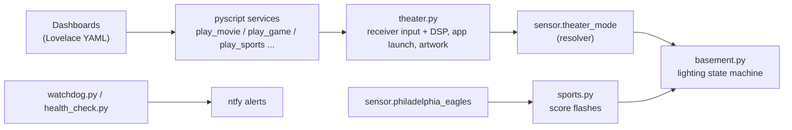

# Basement Theater & Home Automation

[](https://github.com/MFeret11/home-assistant-config/actions/workflows/ci.yml)

The live Home Assistant config for my house, running on a Raspberry Pi 4. Most of it drives a basement home theater: one button picks a mode (movie, game, sports, music), and the system switches the receiver input and sound program, launches the app, sets the lights and shows matching artwork on a wall dashboard. It also shuts the hardware down safely when the session ends.

This repo is the production config. It is mounted straight into the Home Assistant container, so a commit here is a deploy.

## What it does

- **Theater mode resolver.** Works out what is on screen from the streaming box's foreground app (HDMI 1) and the retro-gaming PC's state (HDMI 2), then sets the Yamaha receiver's input and DSP program to match.
- **Lighting state machine.** Two modes: *Daily Driver* (adaptive color temperature, blackout during a movie, a 1% glow when paused, direction-of-travel stair lighting) and *Social* (lights stay on, mood palettes). Theater activity never touches the lights in Social mode.
- **Game-day reactions.** Eagles kickoff, score and game-over flashes on 9 Zigbee bulbs. They pulse brightness only, never color, to avoid flooding the Zigbee mesh.
- **Artwork lookup.** Posters and box art from TMDB, Cinemeta, TVmaze, SteamGridDB, RAWG and the libretro thumbnail repos, with caching and per-service circuit breakers.
- **Dashboards.** Five YAML-mode Lovelace dashboards (basement, kitchen, bedroom, home, diagnostics). They are built from shared templates and checked by a test that resolves every entity and service they reference.

## Safety interlocks

Some of this automation can damage hardware if it gets the order wrong, so these paths are guarded and covered by tests ([details](docs/safety-interlocks.md)):

1. **Projector thermal cutoff.** The lamp needs its fans after power-off. Mains are cut only after a 90 s cooldown *and* two consecutive current readings at or below 0.06 A. If the sensor is unavailable, power stays on.
2. **Retro-gaming PC.** The OS gets a clean software shutdown first, and the relay opens only after current stays below 0.05 A for 12 s, so the file system is never cut mid-write.
3. **Ordered shutdown.** TV box, then receiver zones, then lighting and center-channel reset, then the projector cooldown above.
4. **Power-outage sweep.** After a real power cut (detected from host uptime, so ordinary restarts are skipped), it turns off any basement and bedroom bulbs that came back on, unless someone is down there.
5. **TV tuner preemption.** If both HDHomeRun tuners are busy when the theater wants live TV, it releases one over the tuner's TCP control protocol and sends a notification.

## Architecture



| Path | What lives there |
|---|---|
| [`pyscript/`](pyscript/) | All automation logic in Python (pyscript): `theater.py`, `basement.py`, `sports.py`, `watchdog.py`, `health_check.py` |
| [`packages/`](packages/) | Helpers, template sensors and REST commands per subsystem |
| [`dashboards/`](dashboards/) | Lovelace dashboards; `basement.yaml` is assembled from `components/` |
| [`tests/`](tests/) | Standalone test suites, plus telemetry tools that query the recorder DB |
| [`docs/`](docs/) | Subsystem references: entities, interlocks, lighting, audio, network |

## Hardware

Raspberry Pi 4 (SSD over USB) running Home Assistant Container, Mosquitto and a Matter server in Docker · Sonoff MG24 Zigbee coordinator · Yamaha RX-V673 receiver · Optoma projector on a current-sensing smart plug · Onn 4K Pro (Android TV) · Batocera retro-gaming PC · HDHomeRun Flex Duo, shared remotely over Tailscale through an xTeVe proxy.

## Testing

```bash
python3 tests/run_all_tests.py
```

There are seven suites with about 140 test cases, and they need only the Python standard library. Pyscript's globals (`state`, `task`, `light` and so on) are mocked so the automation modules import as plain Python. The suites cover the lighting state machine and interlocks, replays of 48 hours of recorded sensor data, and an audit of every dashboard binding. CI runs them on every push, along with a [gitleaks](https://github.com/gitleaks/gitleaks) secret scan.

## Working on it

- Credentials live in `secrets.yaml`, which is git-ignored. Code reads them with `!secret` or pyscript's secret reader and never inlines them.
- Check the config before reloading: `docker exec homeassistant python -m homeassistant --script check_config -c /config`
- [`AGENTS.md`](AGENTS.md) holds the rules for AI coding assistants working in this repo: the interlocks and the mistakes that have caused bugs before.

## License

[MIT](LICENSE). The blueprints in `blueprints/` keep their original authors' licenses.
